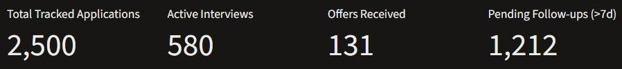
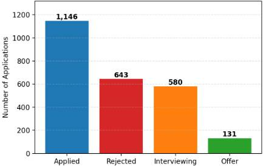
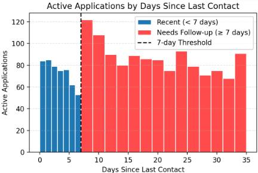

# Job Application Tracker — MCP Server & Live Analytics

A **Model Context Protocol (MCP SDK v2)** server built with Python, `MCPServer`, and `SQLite` that connects LLM agents to a persistent job application database of **2,500+ tracked records**, paired with an interactive **Streamlit** analytics dashboard.

## Architecture & Capabilities
- **MCP Server (`server.py`):**
  - `list_applications(status)` — Query applications filtered by pipeline stage (`Applied`, `Interviewing`, `Offer`, `Rejected`).
  - `add_application(company, role, status, notes)` — Log new opportunities via natural language tool calls.
  - `get_pending_followups(days_threshold)` — Identify active applications awaiting follow-up.
  - `log_followup(company, new_status, note_update)` — Record follow-ups, update contact dates, and append interview notes.
  - `jobs://summary` (MCP Resource) — Live pipeline breakdown by status.
- **MCP Client Demo (`client_demo.py`):** End-to-end async client demonstrating tool discovery, resource reading, and database mutations over the MCP protocol.
- **Live Analytics Dashboard (`dashboard.py`):** Visualizes pipeline metrics and follow-up latency distributions while letting users invoke MCP tools directly.

## Visual Preview

### 1. Live Pipeline KPIs (N = 2,500 Records)


### 2. Application Status Breakdown 


### 3. Follow-up Latency Distribution (7-Day Action Threshold)


## Quickstart
```bash
pip install -r requirements.txt
python client_demo.py
python -m streamlit run dashboard.py
```


